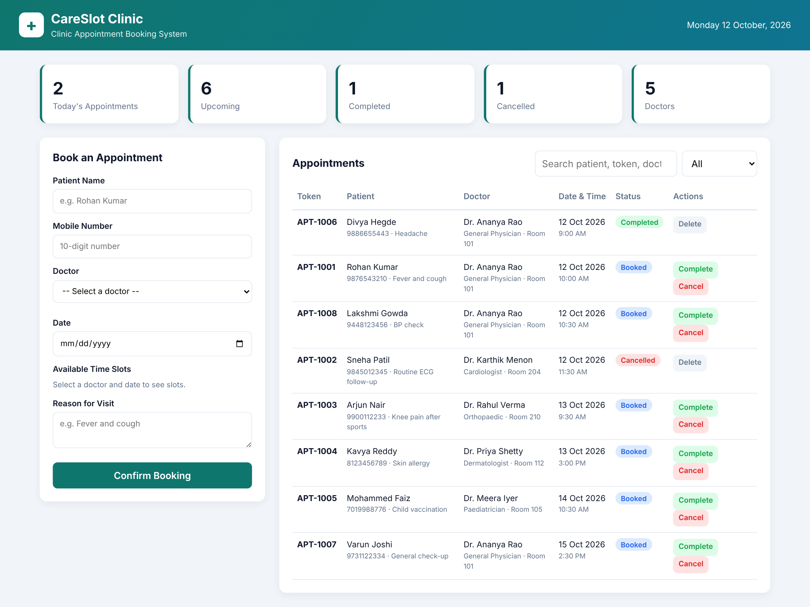
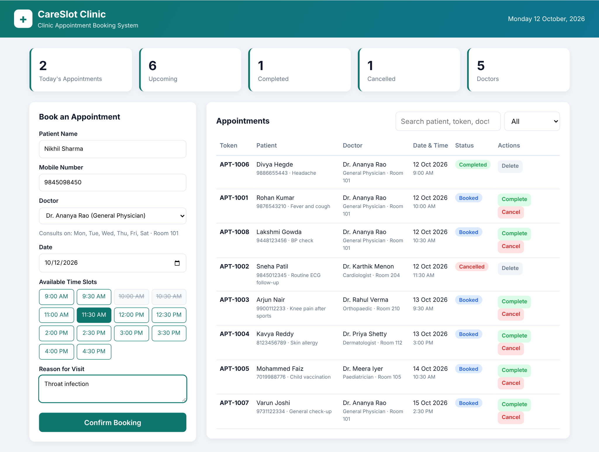
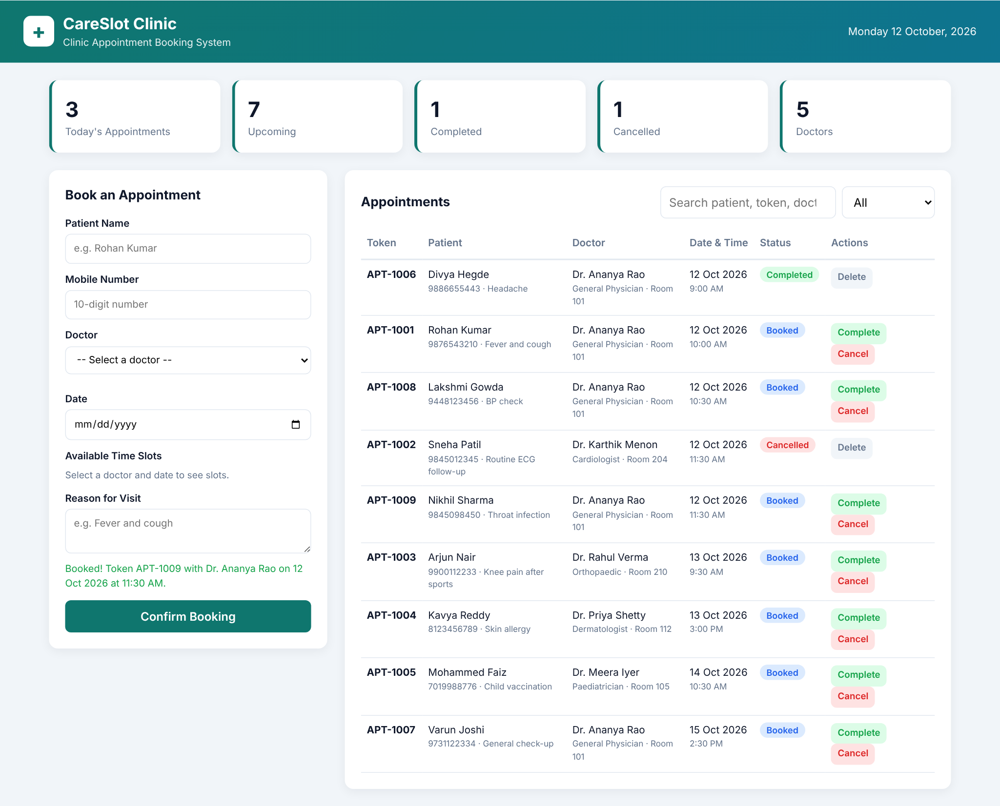
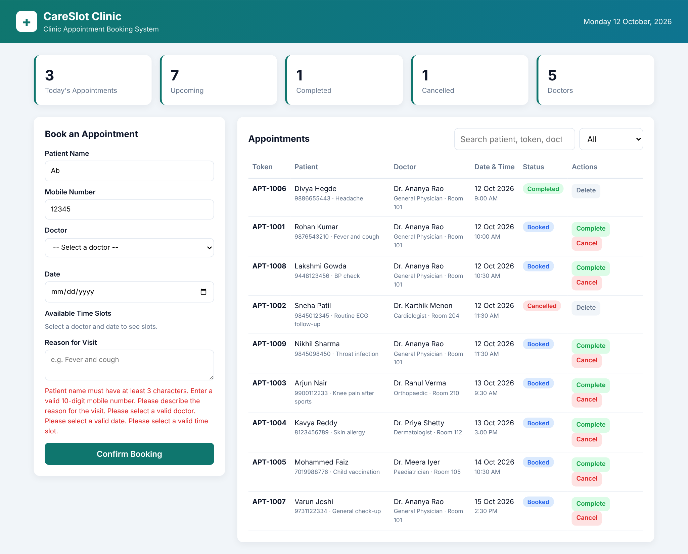
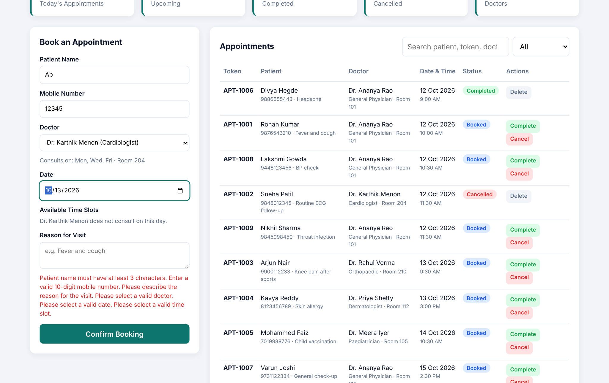
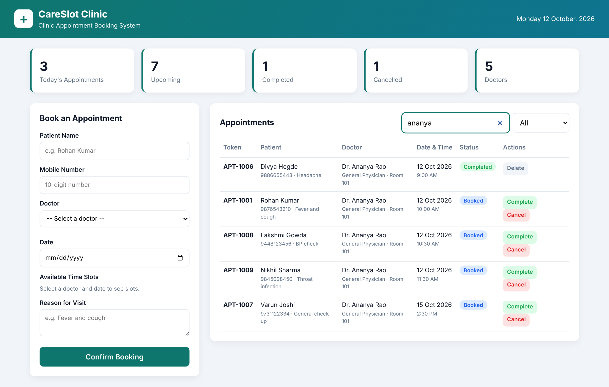
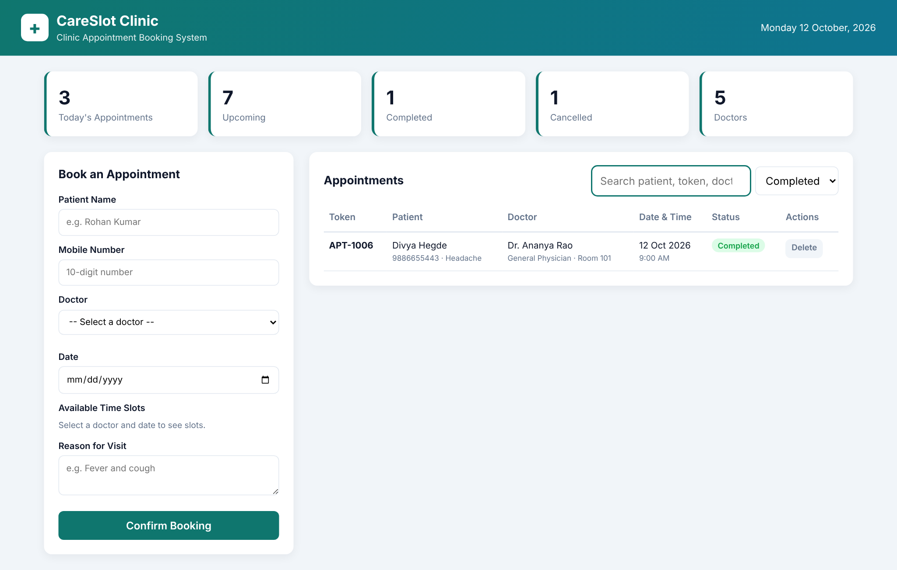
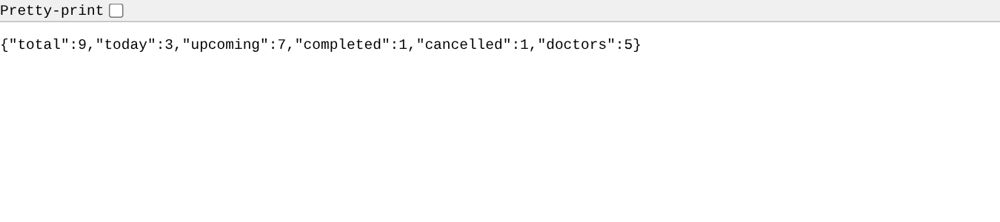
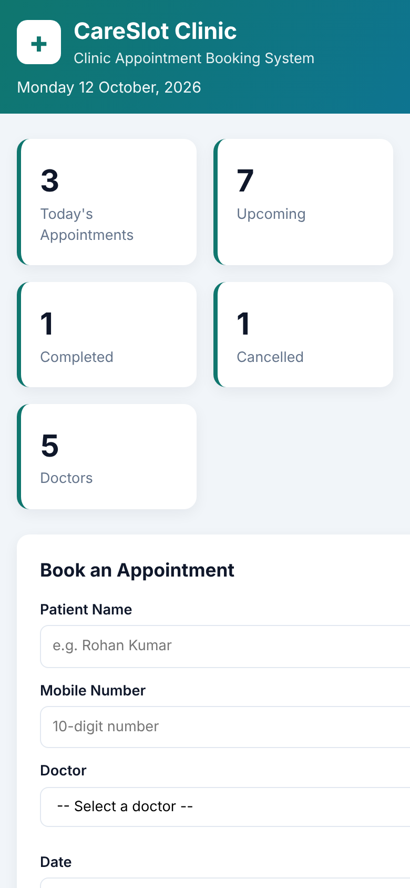

# CareSlot – Clinic Appointment Booking System

A full stack web application for booking and managing doctor appointments at a small clinic. Patients pick a doctor, date and an available 30-minute slot, and clinic staff track each appointment from **Booked** to **Completed** or **Cancelled**.

> AAT-1 (Portfolio-Driven) project · Full Stack Technologies (22CSE71)



---

## Objective

To build a working full stack application with a REST API backend and a responsive frontend that:

- removes manual register/phone-based appointment booking,
- shows only the slots that are actually free for a doctor on a given day,
- prevents two patients from booking the same doctor at the same time, and
- gives the clinic a live dashboard of today's, upcoming, completed and cancelled appointments.

## Features

- **Doctor directory** with specialization, room number and working days
- **Live slot availability.** Booked slots are struck out, and days the doctor doesn't consult show a message
- **Double-booking prevention** on the server (HTTP 409 Conflict)
- **Server-side validation** for name, 10-digit mobile number, past dates, doctor's working day and valid slot
- **Auto-generated token numbers** (APT-1001, APT-1002, …)
- **Appointment management**: mark as Completed, Cancel, Delete records
- **Search** by patient, phone, token, doctor or specialization, plus a **status filter**
- **Dashboard cards**: Today's, Upcoming, Completed, Cancelled, Doctors
- **Persistent storage** in JSON files, so data survives server restarts
- **Responsive UI** that works on mobile screens
- **Zero dependencies**: uses only Node.js core modules, so there's nothing to `npm install`

## Tools & Technologies

| Layer | Technology |
|---|---|
| Frontend | HTML5, CSS3 (Grid, Flexbox, media queries), JavaScript (ES6+, Fetch API, DOM) |
| Backend | Node.js – `http`, `fs`, `path`, `crypto` core modules |
| API style | RESTful JSON API |
| Storage | JSON files (`data/doctors.json`, `data/appointments.json`) |
| Tools | VS Code, Git, GitHub, Google Chrome |

## Project Structure

```
Clinic-Appointment-Booking-System/
├── server.js               # Node.js server: REST API + static file server
├── package.json            # Project info and npm start script
├── data/
│   ├── doctors.json        # Doctor master data
│   └── appointments.json   # Appointment records (auto-updated)
├── public/
│   ├── index.html          # UI layout
│   ├── style.css           # Styling and responsive design
│   └── app.js              # Frontend logic (fetch calls, rendering)
└── screenshots/            # Output screenshots
```

## REST API

| Method | Endpoint | Description |
|---|---|---|
| GET | `/api/doctors` | List all doctors |
| GET | `/api/slots?doctorId=D1&date=2026-10-12` | Free/booked slots for a doctor on a date |
| GET | `/api/appointments?search=&status=All` | List appointments (search + filter) |
| POST | `/api/appointments` | Book a new appointment |
| PATCH | `/api/appointments/:id/status` | Mark as `Completed` or `Cancelled` |
| DELETE | `/api/appointments/:id` | Delete an appointment record |
| GET | `/api/stats` | Dashboard counts |

Example request:

```json
POST /api/appointments
{
  "patientName": "Rohan Kumar",
  "phone": "9876543210",
  "doctorId": "D1",
  "date": "2026-10-12",
  "time": "10:00",
  "reason": "Fever and cough"
}
```

## How to Run

**Prerequisite:** [Node.js](https://nodejs.org) 18 or later.

```bash
git clone https://github.com/<your-username>/Clinic-Appointment-Booking-System.git
cd Clinic-Appointment-Booking-System
npm start
```

Open **http://localhost:3000** in your browser.

To start with an empty clinic, replace the contents of `data/appointments.json` with `[]`.

## Output

| Booking with live slots | Booking confirmed |
|---|---|
|  |  |

| Validation errors | Doctor not available |
|---|---|
|  |  |

| Search | Status filter |
|---|---|
|  |  |

| REST API response | Mobile view |
|---|---|
|  |  |

## Future Enhancements

- MongoDB / MySQL database instead of JSON files
- Login for patients, doctors and admin (JWT authentication)
- SMS / email reminders before the appointment
- Doctor-specific leave calendar and custom timings
- Deploy on Render / Railway for public access

## Author

**M Sahana** · USN: 1NH23CS127 · 7th Semester, Section C
Department of Computer Science and Engineering, New Horizon College of Engineering, Bengaluru
